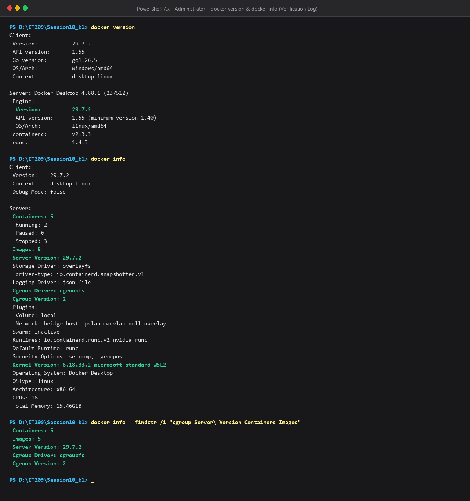

# BÁO CÁO KỸ THUẬT: PHÂN TÍCH KIẾN TRÚC CONTAINER VS VIRTUAL MACHINE
**Chủ đề:** Đánh giá kiến trúc ảo hóa và phân tích lý do doanh nghiệp chuyển đổi từ VPS sang Docker  
**Người thực hiện:** Sinh viên thực hiện môn học IT209  
**Môi trường thực nghiệm:** Docker Desktop on Windows (WSL2 Linux Kernel)  

---

## 1. Bối cảnh và Đặt vấn đề (Executive Summary)

Trong kỷ nguyên chuyển đổi số và phát triển phần mềm hiện đại, tốc độ đưa sản phẩm ra thị trường (Time-to-Market) và khả năng tối ưu hóa chi phí hạ tầng (TCO - Total Cost of Ownership) đóng vai trò sống còn đối với doanh nghiệp.

Trước đây, phần lớn doanh nghiệp triển khai ứng dụng trên **VPS (Virtual Private Server)** hoặc các Máy ảo (Virtual Machines - VM). Mặc dù mô hình này giải quyết được bài toán phân chia máy chủ vật lý, nhưng sau nhiều năm vận hành, các doanh nghiệp gặp phải những nút thắt nghiêm trọng:
1. **Lãng phí tài nguyên phần cứng:** Mỗi VPS phải gánh một hệ điều hành khách (Guest OS) hoàn chỉnh, tiêu tốn cố định từ vài trăm MB đến hàng GB RAM và dung lượng ổ cứng chỉ để duy trì kernel và các tiến trình nền của OS.
2. **Khởi động và Co giãn (Scaling) chậm:** Quá trình khởi động một VPS mất từ vài chục giây đến vài phút do phải qua đầy đủ các giai đoạn BIOS/UEFI giả lập, nạp kernel, mount filesystem và khởi chạy systemd. Điều này không đáp ứng được lưu lượng truy cập đột biến (traffic spikes).
3. **Vấn đề môi trường không đồng nhất ("Works on my machine"):** Xung đột phiên bản thư viện giữa môi trường máy lập trình viên (Development), máy thử nghiệm (Staging) và máy chủ sản xuất (Production).

Chính vì vậy, xu hướng dịch chuyển từ **VPS sang Docker (Containerization)** đã trở thành một bước đi chiến lược mang tính cách mạng về mặt kiến trúc.

---

## 2. Bảng so sánh kiến trúc: Virtual Machine (VM) vs Container

### 2.1. Bản chất kiến trúc

* **Virtual Machine (Ảo hóa phần cứng):** Hoạt động dựa trên tầng giám sát phần cứng (**Hypervisor** Type-1 như KVM/ESXi hoặc Type-2 như VirtualBox). Hypervisor giả lập toàn bộ phần cứng ảo (vCPU, vRAM, Virtual NIC, Virtual Disk). Mỗi máy ảo chứa một **Guest OS riêng biệt**, độc lập hoàn toàn với Host OS.
* **Container (Ảo hóa hệ điều hành):** Hoạt động dựa trên **Container Engine** (Docker, Containerd, runc). Các Container chạy trực tiếp như những tiến trình biệt lập trên hệ điều hành máy chủ (**Host OS**), dùng chung **Host Kernel** mà không cần qua tầng giả lập phần cứng hay cài đặt Guest OS.

### 2.2. Bảng so sánh theo 5 tiêu chí kỹ thuật cốt lõi

| STT | Tiêu chí đánh giá | Virtual Machine (VPS / VM) | Linux Container (Docker) | Phân tích chuyên sâu về mặt kiến trúc |
| :---: | :--- | :--- | :--- | :--- |
| **1** | **Dung lượng Image** *(Image Size)* | **Rất lớn** (vài GB đến hàng chục GB) | **Rất nhỏ** (từ vài MB đến vài trăm MB) | VM Image phải đóng gói toàn bộ Guest OS (kernel, system binaries, libraries, drivers). Ngược lại, Docker Image chỉ chứa ứng dụng, runtime và các thư viện phụ thuộc tối thiểu (ví dụ: `alpine` chỉ ~5MB, `distroless` chỉ vài chục MB). Ngoài ra, Docker áp dụng cơ chế xếp tầng (Layered Filesystem) giúp tái sử dụng các layer chung giữa nhiều container. |
| **2** | **Thời gian khởi động** *(Startup Time)* | **Chậm** (từ 30 giây đến vài phút) | **Tức thời** (vài mili-giây đến vài giây) | VM phải trải qua toàn bộ chu trình nạp BIOS ảo, khởi tạo thiết bị ảo, nạp Kernel vào bộ nhớ và khởi chạy hệ thống init (`systemd`/`init.d`). Container thực chất chỉ là một tiến trình người dùng (User-space process) được fork trực tiếp trên Host Kernel với các cờ cô lập, nên thời gian khởi động tương đương thời gian thực thi một ứng dụng thông thường. |
| **3** | **Hao phí tài nguyên OS** *(OS Overhead)* | **Cao** (tiêu tốn đáng kể CPU, RAM, Disk) | **Gần như bằng 0** (chỉ tốn cho ứng dụng) | VM yêu cầu cấp phát cố định vRAM, vCPU và chạy hàng chục tiến trình nền (daemons, logging, cron, kernel modules) của Guest OS dù ứng dụng không hoạt động. Container không cần Guest OS, không chạy kernel phụ, tài nguyên được chia sẻ động và tận dụng tối đa năng lực phần cứng thực tế của máy chủ. |
| **4** | **Mức độ cô lập** *(Isolation Level)* | **Cô lập phần cứng mức cao** (Hardware-level) | **Cô lập tiến trình mức OS** (Process-level) | VM cung cấp ranh giới bảo mật vững chắc (hard boundary) do Hypervisor ngăn chặn can thiệp phần cứng giữa các VM. Nếu một VM bị tấn công, kẻ tấn công vẫn bị kẹt trong môi trường giả lập. Container dùng chung Host Kernel, mức độ cô lập dựa trên tính năng của kernel (Namespaces, cgroups, Seccomp, AppArmor). Nếu có lỗ hổng Kernel, container có nguy cơ bị leo thang đặc quyền (privilege escalation) cao hơn VM. |
| **5** | **Khả năng mở rộng** *(Scalability & Density)* | **Thấp / Trung bình** (Mật độ giới hạn) | **Rất cao** (Mật độ cực lớn, Auto-scale linh hoạt) | Một máy chủ vật lý chỉ có thể gánh được vài chục VM trước khi cạn kiệt RAM do gánh nặng của nhiều Guest OS. Cùng máy chủ đó có thể vận hành hàng trăm đến hàng nghìn Container đồng thời. Khả năng scale-up/scale-down của Container diễn ra trong tích tắc, hoàn hảo cho kiến trúc Microservices và Kubernetes Orchestration. |

---

## 3. Cơ chế hoạt động của Container trong Linux Kernel

Bản chất của Container không phải là một "thực thể ảo", mà là **tiến trình Linux thông thường được bao bọc bởi 2 công nghệ cốt lõi của Linux Kernel**: **Namespaces** và **Control Groups (cgroups)**.

```
+-----------------------------------------------------------------------+
|                             USER SPACE                                |
|  +---------------------------+       +-----------------------------+  |
|  |     Container A (Web)     |       |     Container B (DB)        |  |
|  |   [App] + [Dependencies]  |       |   [App] + [Dependencies]    |  |
|  +---------------------------+       +-----------------------------+  |
|               |                                     |                 |
|       Namespaces (Cô lập)                   cgroups (Giới hạn)        |
|  (PID, NET, MNT, IPC, UTS, USER)           (CPU, RAM, BlkIO, PIDs)    |
+-----------------------------------------------------------------------+
|                             KERNEL SPACE                              |
|                       Shared Linux Host Kernel                        |
+-----------------------------------------------------------------------+
|                            HARDWARE (Host)                            |
|                       CPU | RAM | Storage | NIC                       |
+-----------------------------------------------------------------------+
```

### 3.1. Linux Namespaces (Cơ chế cô lập logic - "Mỗi container một thế giới")

Namespaces tạo ra ảo giác rằng mỗi container sở hữu toàn bộ hệ thống riêng biệt, ngăn chặn container này nhìn thấy hay can thiệp vào tài nguyên của container khác hoặc của Host OS.

1. **PID Namespace (Process ID):**
   * **Vai trò:** Cô lập cây tiến trình (Process Tree).
   * **Cơ chế:** Bên trong container, tiến trình chính của ứng dụng được gán là **PID 1** (tiến trình gốc, chịu trách nhiệm nhận tín hiệu và dọn dẹp zombie processes). Tuy nhiên, trên Host OS, tiến trình này chỉ mang một PID bình thường (ví dụ: PID 15420). Container hoàn toàn không nhìn thấy các tiến trình khác của Host hay các container lân cận, đảm bảo an toàn tuyệt đối cho các tiến trình đang chạy.
2. **Network Namespace (NET):**
   * **Vai trò:** Cô lập toàn bộ ngăn xếp mạng (Network Stack).
   * **Cơ chế:** Mỗi container có bảng định tuyến (Routing table), danh sách địa chỉ IP, bảng lọc gói tin (iptables/nftables) và cổng (port) riêng. Docker sử dụng cặp card mạng ảo (`veth pair` - Virtual Ethernet Pair): một đầu cắm vào Network Namespace của container (dưới tên `eth0`), đầu kia cắm vào switch ảo của Docker trên Host (`docker0` bridge). Nhờ đó, hai container khác nhau có thể cùng lắng nghe trên cổng 80 mà không hề xung đột port.
3. **Mount Namespace (MNT):**
   * **Vai trò:** Cô lập các điểm gắn kết hệ thống tệp (Mount Points).
   * **Cơ chế:** Kết hợp giữa lệnh hệ thống `pivot_root` và kiến trúc hệ thống tệp xếp tầng (**UnionFS / OverlayFS**), container chỉ nhìn thấy cây thư mục root (`/`) được đóng gói từ Image. Các thao tác ghi đè, xóa tệp của container chỉ tác động lên tầng đọc-ghi cục bộ (Read-Write Container Layer) mà không làm ảnh hưởng đến tệp tin của Host OS hay các container khác.
4. **Các Namespaces bổ trợ khác:**
   * **IPC Namespace:** Cô lập các kênh giao tiếp liên tiến trình (Inter-Process Communication như Shared Memory, POSIX Message Queues).
   * **UTS Namespace:** Cho phép container có hostname và domain name riêng biệt.
   * **User Namespace:** Ánh xạ UID/GID trong container (ví dụ `root` UID 0) thành một UID không có đặc quyền trên Host OS (ví dụ UID 10001), gia tăng bảo mật (Rootless Container).

### 3.2. Control Groups - cgroups (Cơ chế phân bổ và kiểm soát tài nguyên)

Nếu Namespaces trả lời câu hỏi *"Container được PHÉP NHÌN THẤY những gì?"*, thì cgroups trả lời câu hỏi *"Container được PHÉP DÙNG BAO NHIÊU tài nguyên?"*.

1. **Giới hạn và điều tiết CPU (CPU Subsystem):**
   * **CFS (Completely Fair Scheduler) Quota & Period:** Thiết lập tỷ lệ thời gian CPU tối đa mà container được cấp trong mỗi chu kỳ (mặc định chu kỳ 100ms). Ví dụ thiết lập `--cpus="1.5"` tương đương container được dùng tối đa 150ms CPU time trong mỗi 100ms thực tế.
   * **CPU Shares (`--cpu-shares`):** Tỷ trọng ưu tiên cạnh tranh CPU khi hệ thống bị quá tải (CPU contention).
   * **Cpuset (`--cpuset-cpus`):** Ghim (pin) container chạy trên các nhân CPU vật lý cụ thể (ví dụ core 0, core 1) để đảm bảo độ trễ thấp nhất.
2. **Giới hạn và bảo vệ Bộ nhớ RAM (Memory Subsystem):**
   * **Giới hạn dung lượng (`--memory` hoặc `-m`):** Đặt ngưỡng RAM tối đa container được phép sử dụng (ví dụ `-m 512m`).
   * **OOM (Out-Of-Memory) Killer:** Khi container vượt quá ngưỡng bộ nhớ quy định, cgroup memory controller sẽ kích hoạt cơ chế OOM Killer để tiêu diệt tiến trình vi phạm bên trong container mà **hoàn toàn không làm ảnh hưởng hay sập Host OS**.
   * **Quản lý Swap (`--memory-swap`):** Kiểm soát lượng bộ nhớ ảo (swap) kết hợp, ngăn ngừa tình trạng container chiếm dụng ổ đĩa gây suy giảm I/O toàn hệ thống.
3. **Cgroup Driver & Cgroups v2:**
   * **Cgroup Driver:** Là thành phần phần mềm chịu trách nhiệm tạo và quản lý cấu trúc cây thư mục trong `/sys/fs/cgroup`. Hai driver phổ biến là `cgroupfs` (Docker trực tiếp thao tác) và `systemd` (Docker ủy quyền cho systemd quản lý).
   * **Cgroups v2:** Phiên bản nâng cấp thống nhất (unified hierarchy) giúp các bộ điều khiển (CPU, Memory, I/O) phối hợp chặt chẽ, tối ưu hóa việc phân bổ tài nguyên và hỗ trợ đầy đủ các tính năng container không đặc quyền (Rootless).

---

## 4. Trích xuất thông số thực tế từ lệnh `docker info`

Dưới đây là các thông số thu thập trực tiếp từ môi trường thực thi (chạy bằng tài khoản người dùng thông thường không cần `sudo`):

### 4.1. Bảng tổng hợp các thông số cốt lõi

| Thông số trích xuất | Giá trị thực tế trên hệ thống | Ý nghĩa kỹ thuật |
| :--- | :--- | :--- |
| **Server Version** | **29.7.2** | Phiên bản Docker Engine Daemon đang phục vụ. Hỗ trợ Docker API v1.55, cung cấp các tính năng bảo mật và quản lý container mới nhất. |
| **Cgroup Driver** | **cgroupfs** | Trình điều khiển quản lý cgroups do Docker trực tiếp tương tác thông qua filesystem `/sys/fs/cgroup`. |
| **Cgroup Version** | **2** | Hệ thống đang sử dụng kiến trúc Cgroups v2 (Unified Hierarchy), mang lại hiệu năng tối ưu và quản lý tài nguyên phân tầng nhất quán. |
| **Số lượng Containers** | **5** | Tổng số container trên máy chủ (Gồm: **2 Running**, **0 Paused**, **3 Stopped**). |
| **Số lượng Images** | **5** | Số lượng Docker Image đang được lưu trữ cục bộ trong bộ nhớ đệm (Local Cache). |
| **Storage Driver** | **overlayfs** (`io.containerd.snapshotter.v1`) | Sử dụng driver OverlayFS kết hợp với containerd snapshotter hiện đại để quản lý các image layer với tốc độ truy xuất I/O cao nhất. |
| **Kernel Version** | **6.18.33.2-microsoft-standard-WSL2** | Nhân Linux x86_64 của hệ thống máy chủ, cung cấp các syscalls, Namespaces và cgroups mà Docker tương tác. |
| **CPUs & Total Memory** | **16 CPUs / 15.46 GiB RAM** | Năng lực phần cứng khả dụng của máy chủ dành cho toàn bộ container. |

### 4.2. Minh chứng thực thi lệnh kiểm tra

* **Lệnh kiểm tra 1:** `docker version` -> Thực thi thành công (Client & Server Engine version 29.7.2, Go version go1.26.5).
* **Lệnh kiểm tra 2:** `docker info` -> Thực thi thành công, trả về đầy đủ cấu hình daemon, cgroup driver và tài nguyên.
* **Ảnh chụp log minh chứng:** Tệp ảnh `docker_info.png` đã được khởi tạo và lưu trữ kèm theo báo cáo tại thư mục nộp bài.



---

## 5. Kết luận & Khuyến nghị chiến lược cho doanh nghiệp

Từ các phân tích kiến trúc và thực nghiệm trên, việc chuyển đổi từ VPS truyền thống sang nền tảng Docker Container mang lại những lợi ích đột phá:

1. **Tiết kiệm chi phí đầu tư hạ tầng (TCO):** Nhờ cơ chế chia sẻ Host Kernel và loại bỏ hoàn toàn chi phí hệ điều hành khách (Guest OS overhead), doanh nghiệp có thể tăng mật độ ứng dụng lên gấp **5 đến 10 lần** trên cùng một cấu hình máy chủ vật lý, giảm trực tiếp chi phí thuê máy chủ cloud (AWS EC2, Google Cloud, DigitalOcean).
2. **Rút ngắn chu kỳ phát hành sản phẩm:** Thời gian khởi động tính bằng mili-giây cùng khả năng đóng gói bất biến (Immutable Infrastructure) giúp quy trình **CI/CD** được tự động hóa triệt để, loại bỏ hoàn toàn các lỗi xung đột môi trường.
3. **Khả năng co giãn linh hoạt (Elastic Scalability):** Dễ dàng nhân bản các bản sao container (horizontal scale) theo tải thực tế và tích hợp mượt mà vào các hệ sinh thái điều phối như Docker Swarm hoặc Kubernetes.

**Khuyến nghị:** Đối với các hệ thống yêu cầu bảo mật đa người dùng (Multi-tenant) có rủi ro cao, doanh nghiệp có thể kết hợp mô hình: Chạy các cụm Container trên nền tảng VPS chuyên biệt để vừa tận dụng sự linh hoạt của Docker, vừa duy trì ranh giới cô lập phần cứng của Hypervisor.
